# Plan Maestro de Arquitectura y Despliegue
## Proyecto: Naruto Jutsu Detector (`naruto-jutsu-detector`)

Este documento especifica la ingeniería, modelos de visión por computadora, máquina de estados finitos (FSM) y arquitectura de despliegue para el detector interactivo de sellos y jutsus de Naruto utilizando **OpenCV**, **MediaPipe** y despliegue a 60 FPS en **GitHub Pages**.

---

## 1. Visión General del Proyecto

El objetivo es construir un sistema de visión artificial en tiempo real capaz de:
1. Detectar y rastrear los **21 puntos clave (landmarks) 3D** de ambas manos.
2. Reconocer con alta precisión geométrica los **sellos de manos clásicos del universo de Naruto** (*Tigre, Carnero, Serpiente, Dragón, Caballo, Mono, Buey, Jabalí, Cruz de Clones*).
3. Administrar una **Máquina de Estados Finitos (FSM) con búfer temporal** que verifique la secuencia y cadencia correcta de sellos para liberar un Jutsu.
4. Renderizar efectos visuales dinámicos (partículas de fuego, arcos eléctricos, chakra rotatorio) y reproducir audio característico.

---

## 2. Arquitectura Dual (Python Engine + WebApp GitHub Pages)

Para maximizar el impacto en tu portafolio, el proyecto implementa dos capas complementarias:

```mermaid
flowchart TD
    subgraph Local["Motor Python Local (Investigación & Algoritmos)"]
        CamPy["Webcam"] --> MP_Py["MediaPipe Hands (Python)"]
        MP_Py --> Geo["Clasificador Geométrico & Ángulos Falángicos"]
        Geo --> FSM_Py["FSM Temporal de Combos (deque)"]
        FSM_Py --> FX_Py["OpenCV Canvas & Pygame Audio FX"]
    end

    subgraph Web["Despliegue Web GitHub Pages (Sin Servidor / 60 FPS)"]
        CamWeb["Navegador Web (WebRTC)"] --> MP_JS["@mediapipe/tasks-vision (WASM/WebGL)"]
        MP_JS --> WebGeo["Clasificador In-Browser (TypeScript/JS)"]
        WebGeo --> WebFSM["FSM de Jutsus"]
        WebFSM --> WebCanvas["WebGL / 2D Canvas VFX Particles + Web Audio API"]
    end
```



### Ventajas de esta Arquitectura Dual:
- **Python (`src/`)**: Demuestra dominio de Python, POO, OpenCV, matemáticas de vectores 3D y diseño de software estructurado.
- **GitHub Pages (`web/` o `docs/`)**: Permite que cualquier reclutador o colega abra una URL (`https://luismongp.github.io/naruto-jutsu-detector/`), active su cámara y experimente el proyecto instantáneamente **sin necesidad de clonar repositorios ni instalar dependencias**.

---

## 3. Catálogo de Sellos y Jutsus

| Sello / Jutsu | Descripción Anatómica de Manos | Efecto Visual Renderizado |
| :--- | :--- | :--- |
| **Tigre (*Tora*)** | Dedos índice y pulgar extendidos hacia arriba en ambas manos entrelazadas | Aura de chakra naranja pulsante |
| **Serpiente (*Mi*)** | Todos los dedos entrelazados horizontalmente a la altura del pecho | Resplandor esmeralda tenue |
| **Carnero (*Hitsuji*)** | Dedos índice y medio de la mano derecha erguidos, envueltos por la izquierda | Canalización de chakra concentrada |
| **Mono (*Saru*)** | Pulgares paralelos horizontales y dedos doblados | Destellos estáticos |
| **Cruz (*Kage Bunshin*)** | Índices y medios cruzados en ángulo perpendicular (90°) formando una cruz | Nube de humo volumétrica y duplicación de cámara |
| **Katon: Gōkakyū no Jutsu** | Secuencia: *Serpiente → Carnero → Mono → Jabalí → Caballo → Tigre* | Gran esfera de fuego proyectada desde el origen de la boca/manos |
| **Chidori (Millar de Aves)** | Secuencia: *Buey → Liebre → Mono* (o mano izquierda sujetando muñeca derecha) | Rayos eléctricos dinámicos y sonido agudo de electricidad en la palma |
| **Rasengan** | Mano cóncava rotatoria con palma extendida | Esfera giratoria de chakra azul con partículas de turbulencia ancladas al centro de la palma |

---

## 4. Clasificación Geométrica Invariante a Escala

Para que el detector funcione sin importar la distancia del usuario a la cámara o el tamaño de sus manos, las coordenadas de los 21 landmarks se normalizan vectorialmente:

1. **Traslación al Origen**:
   $$\vec{P}'_i = \vec{P}_i - \vec{P}_0 \quad (\text{donde } \vec{P}_0 \text{ es la muñeca})$$
2. **Escalamiento por Tamaño de Palma**:
   $$d_{\text{ref}} = \|\vec{P}_9 - \vec{P}_0\| \quad (\text{distancia entre muñeca y base del dedo medio})$$
   $$\vec{P}''_i = \frac{\vec{P}'_i}{d_{\text{ref}}}$$
3. **Cálculo de Ángulos Inter-Falángicos**:
   Ángulos entre metacarpianos y falanges para determinar con precisión si cada dedo está completamente extendido, semi-flexionado o cerrado en puño.

---

## 5. Estructura del Repositorio

```
naruto-jutsu-detector/
├── .github/
│   └── workflows/
│       └── deploy-pages.yml       # Despliegue automático de la WebApp
├── docs/                           # Aplicación Web para GitHub Pages (60 FPS)
│   ├── index.html                 # Interfaz interactiva de la cámara
│   ├── css/
│   │   └── anime-hud.css          # Estilo HUD inspirado en Naruto / Ninja Scroll
│   ├── js/
│   │   ├── app.js                 # Coordinador principal y cámara WebRTC
│   │   ├── hand_tracker.js        # MediaPipe Hands Tasks-Vision
│   │   ├── seal_detector.js       # Reconocimiento geométrico de sellos
│   │   ├── jutsu_fsm.js           # Gestor de secuencias y combos
│   │   └── particles.js           # Sistema de partículas (Fuego, Chidori, Rasengan)
│   └── audio/                     # SFX de jutsus clásicos
├── src/                           # Motor Python Local
│   ├── __init__.py
│   ├── hand_tracker.py            # Wrapper de MediaPipe en Python
│   ├── seal_classifier.py         # Extracción de ángulos y clasificación
│   ├── jutsu_fsm.py               # Máquina de estados con deque
│   ├── particle_fx.py             # Generador de efectos sobre frames OpenCV
│   └── main.py                    # Punto de entrada para ejecutar localmente
├── tests/
│   └── test_seals.py              # Tests unitarios con landmarks sintéticos
├── pyproject.toml                 # Configuración de dependencias Python (uv / pip)
├── README.md                      # Documentación completa y badges
└── LICENSE                        # MIT
```

---

## 6. Hoja de Ruta para su Construcción

- [ ] **Fase 1**: Configurar el repositorio local en `D:\Documentos\Github\naruto-jutsu-detector` con entorno y dependencias (`opencv-python`, `mediapipe`).
- [ ] **Fase 2**: Implementar el extractor de ángulos y clasificador de sellos básicos (*Tigre, Carnero, Serpiente, Cruz*).
- [ ] **Fase 3**: Implementar la máquina de estados temporal con tolerancia a fallos transitorios (debounce de frames).
- [ ] **Fase 4**: Construir la aplicación web estática en `docs/` con `@mediapipe/tasks-vision` y partículas canvas en tiempo real.
- [ ] **Fase 5**: Crear el workflow de GitHub Actions para publicar en GitHub Pages.
