# Naruto Jutsu Detector en Tiempo Real
### `naruto-jutsu-detector`

[](https://www.python.org/)
[](https://opensource.org/licenses/MIT)
[](https://opencv.org/)
[](https://developers.google.com/mediapipe)
[](https://luismongp.github.io/naruto-jutsu-detector/)

Detector de sellos de manos y activación de Jutsus del universo de **Naruto** en tiempo real mediante **visión por computadora (MediaPipe Hands & OpenCV)** y despliegue interactivo en el navegador a **60 FPS con WebGL y Canvas en GitHub Pages**.

---

## ⚡ Demo Interactiva en Vivo

Prueba la aplicación web en tiempo real directamente desde tu navegador:
👉 **[https://luismongp.github.io/naruto-jutsu-detector/](https://luismongp.github.io/naruto-jutsu-detector/)**

---

## Arquitectura del Sistema

```mermaid
flowchart TD
    subgraph Local["Motor Python Local (Investigación & Algoritmos)"]
        CamPy["Webcam"] --> MP_Py["MediaPipe Hands (Python)"]
        MP_Py --> Geo["Clasificador Geométrico & Ángulos Falángicos"]
        Geo --> FSM_Py["FSM Temporal de Combos (deque)"]
        FSM_Py --> FX_Py["OpenCV Canvas & Pygame Audio FX"]
    end

    subgraph Web["Despliegue Web GitHub Pages (Sin Servidor / 60 FPS)"]
        CamWeb["Navegador Web (WebRTC)"] --> MP_JS["MediaPipe Tasks-Vision (WASM/WebGL)"]
        MP_JS --> WebGeo["Clasificador In-Browser (JavaScript)"]
        WebGeo --> WebFSM["FSM de Jutsus"]
        WebFSM --> WebCanvas["WebGL / 2D Canvas VFX Particles"]
    end
```



---

## Jutsus y Sellos Soportados

| Jutsu | Secuencia de Sellos | Efecto VFX Renderizado |
| :--- | :--- | :--- |
| **Katon: Gōkakyū no Jutsu** | `Serpiente` ➔ `Carnero` ➔ `Tigre` | Esfera y llamaradas de fuego volumétrico |
| **Chidori (Millar de Aves)** | `Tigre` ➔ `Carnero` | Rayos eléctricos y destellos azul-blanco |
| **Rasengan** | `Palma Abierta` | Esfera de chakra rotatoria con partículas orbitales |
| **Kage Bunshin no Jutsu** | `Sello de Cruz` | Cortina de humo volumétrica y clonación |

---

## Instalación y Ejecución Local (Python)

```bash
# 1. Clonar el repositorio
git clone https://github.com/LuisMonGP/naruto-jutsu-detector.git
cd naruto-jutsu-detector

# 2. Instalar dependencias
pip install -r requirements.txt
# O con uv:
uv sync

# 3. Ejecutar motor local
python src/main.py

# 4. Correr tests
pytest tests/
```

---

## Licencia

Distribuido bajo la Licencia **MIT**. Consulta `LICENSE` para más información.
